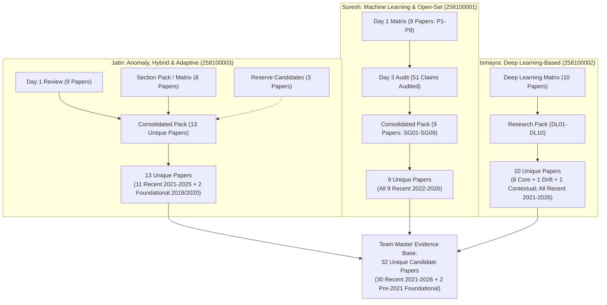

# Source Material Inventory and Safe Ingestion Audit Report

**Project Title:** IILM Survey Paper — Detecting Previously Unseen Network Attacks  
**Evidence Repository:** `https://github.com/ismayra-devx/detecting-previously-unseen-network-attacks.git`  
**Execution Date:** 17 November 2026  
**Auditor:** Antigravity AI (Stage 1 / Prompt 1 Audit)  
**Deliverables Produced:**
- `source_inventory.md` (this comprehensive inventory report)
- `source-to-paper crosswalk.xlsx` (multi-sheet master crosswalk workbook)

---

## 1. Executive Summary & Source Hierarchy

In accordance with Prompt 1 instructions, a comprehensive, non-destructive audit was performed on all 17 files located within `source_material/`. Every file was programmatically opened, parsed, and verified without encountering read errors or corruption.

### Applied Source Priority Hierarchy
To resolve discrepancies across drafts and member notes, the following strict source priority was enforced:
1. **Official IILM Template (`IILM_Survey_Paper_Template(1).docx`)**: Governs all structural formatting, A4 page layout (2 cm margins), Times New Roman 10.5 pt typography, section order, Block A cover page specifications, and Block D annexure requirements.
2. **Suresh Day 3 Verification Report (`Suresh_Day3_Verification_Report.docx`)**: Highest authority for correcting Suresh’s Day 1 matrix and Day 2 draft; overrides all preliminary claims made in earlier drafts.
3. **Consolidated Research Packs (`Jatin_Consolidated_Research_Pack.docx` and `Suresh_Gopal_Consolidated_Research_Pack.docx`)**: Authoritative compilations for member-level literature records, category text, research gaps, and future directions.
4. **Ismayra’s Deep Learning Research Pack (`Ismayra_Deep_Learning_Research/`)**: Authoritative source for the Deep Learning-Based Detection category (Section IV-B), encompassing the multi-sheet matrix, Markdown notes, BibTeX database, and import rules.
5. **Original Member Files (`original_member_submissions/`)**: Retained strictly as an audit trail to track revisions, claims evolution, and preliminary search notes.
6. **Existing Draft (`existing_draft_non_authoritative/`)**: Working reference only; non-authoritative over the official template and consolidated member packs.

---

## 2. File Inventory & Ingestion Status

All **17 files** in `source_material/` were successfully discovered, opened, and inspected. Zero files were unreadable.

| # | File Path / Name | Extension | Size | Source Purpose & Member Owner | Open Status & Content Summary | Authority Level |
|---|---|---|---|---|---|---|
| **1** | `source_material/IILM_Survey_Paper_Template(1).docx` | `.docx` | 90,622 B | **Institutional / Shared Team Baseline** Official survey paper template defining layout, typography, section sequence, Block A cover page, and Block D annexure. | **OPENED_OK** 198 paragraphs, 23 tables. Formats cover page, guidelines, paper body, and annexure tables. | **AUTHORITATIVE FORMAT BASELINE** (Highest structural priority) |
| **2** | `source_material/Jatin_Consolidated_Research_Pack.docx` | `.docx` | 51,419 B | **Jatin (258100003)** Authoritative consolidated member pack for *Anomaly-Based, Hybrid and Adaptive Detection*. Reconciles Day 1 (9 papers) and Section Pack (8 papers) into 13 unique papers (JTN01–JTN13). | **OPENED_OK** 70 paragraphs, 16 tables. Contains register of 13 unique papers, Section IV-C draft, 5 gaps, 4 directions. | **AUTHORITATIVE MEMBER PACK** (Jatin Category) |
| **3** | `source_material/Suresh_Gopal_Consolidated_Research_Pack.docx` | `.docx` | 51,423 B | **Suresh Gopal Singh (258100001)** Authoritative consolidated member pack for *Machine Learning and Open-Set Detection*. Integrates Day 1 matrix, Day 2 draft (Intro & IV-A), and Day 3 verification audit across 9 candidate papers (SG01–SG09). | **OPENED_OK** 68 paragraphs, 13 tables. Contains register of 9 papers, corrected Section IV-A draft, 2 gaps, 2 directions. | **AUTHORITATIVE MEMBER PACK** (Suresh Category) |
| **4** | `source_material/existing_draft_non_authoritative/IILM_Survey_Detecting_Previously_Unseen_Network_Attacks.docx` | `.docx` | 210,358 B | **Team Compilation (Coord. Ismayra Praveen)** Early working draft compiling a preliminary 26-paper survey across all three categories with pre-rendered tables. | **OPENED_OK** 169 paragraphs, 16 tables, 26 references. Preliminary synthesis. | **NON-AUTHORITATIVE WORKING REFERENCE** |
| **5** | `source_material/existing_draft_non_authoritative/IILM_Survey_Detecting_Previously_Unseen_Network_Attacks.pdf` | `.pdf` | 503,967 B | **Team Compilation (Coord. Ismayra Praveen)** Compiled 14-page PDF rendering of the early working draft, providing visual and layout reference. | **OPENED_OK** 14 pages. Rendered layout of preliminary draft. | **NON-AUTHORITATIVE WORKING REFERENCE** |
| **6** | `source_material/Ismayra_Deep_Learning_Research/ANTIGRAVITY_IMPORT_INSTRUCTIONS.txt` | `.txt` | 1,539 B | **Ismayra Praveen (258100002)** Procedural rules for importing Ismayra's research pack, handling open-access PDFs, and preserving pending reading/verification statuses. | **OPENED_OK** 20 lines, 1,537 characters. Establishes DL06 as drift and DL10 as contextual only. | **AUTHORITATIVE PROCEDURAL GUIDANCE** |
| **7** | `source_material/Ismayra_Deep_Learning_Research/Ismayra_Deep_Learning_References.bib` | `.bib` | 4,957 B | **Ismayra Praveen (258100002)** Complete BibTeX bibliographic database for 10 candidate deep learning studies (DL01–DL10). | **OPENED_OK** 111 lines. Full BibTeX entries with DOIs, author lists, and venues. | **AUTHORITATIVE BIBLIOGRAPHIC SOURCE** |
| **8** | `source_material/Ismayra_Deep_Learning_Research/Ismayra_Deep_Learning_Research_Matrix.xlsx` | `.xlsx` | 19,888 B | **Ismayra Praveen (258100002)** Structured multi-sheet research matrix covering 10 deep learning papers (DL01–DL10), method families, unseen testing protocols, findings, limitations, and reading checklists. | **OPENED_OK** 4 sheets: *Read Me*, *Deep Learning Papers*, *Method Comparison*, *Member Reading Checklist*. | **AUTHORITATIVE MEMBER PACK** (Ismayra Category) |
| **9** | `source_material/Ismayra_Deep_Learning_Research/Ismayra_Deep_Learning_Research_Notes.md` | `.md` | 19,133 B | **Ismayra Praveen (258100002)** Analytical research notes synthesising deep learning detection methods, paper evaluations (DL01–DL10), research gaps, and future directions for Section IV-B. | **OPENED_OK** 164 lines, 19,101 characters. Structured commentary and synthesis text. | **AUTHORITATIVE SYNTHESIS NOTES** |
| **10** | `source_material/original_member_submissions/Jatin_Day1_Literature_Review(1).docx` | `.docx` | 25,033 B | **Jatin (258100003)** Initial Day 1 literature review covering 9 candidate papers ([1]–[9]), initial reading status declaration (only [1] read in full), technique summary, and 3 research gaps. | **OPENED_OK** 52 paragraphs, 14 tables. Initial submission records. | **AUDIT TRAIL / HISTORICAL SUBMISSION** |
| **11** | `source_material/original_member_submissions/Jatin_Day2_Day3_Deliverables.docx` | `.docx` | 52,966 B | **Jatin (258100003)** Day 2/3 deliverable drafting Section IV-C, Table I, Table II, 4 research gaps, 4 future directions, draft trend chart, and declaration templates based on Day 1's 9 papers. | **OPENED_OK** 51 paragraphs, 6 tables. Initial section draft and tables. | **AUDIT TRAIL / HISTORICAL SUBMISSION** |
| **12** | `source_material/original_member_submissions/Jatin_Literature_Matrix.xlsx` | `.xlsx` | 10,979 B | **Jatin (258100003)** Jatin's second literature matrix spreadsheet containing 8 papers ([J1]–[J8]), 3 reserve papers, and initial web search log with unrecorded hit counts. | **OPENED_OK** 3 sheets: *Matrix*, *Reserve_papers*, *Search_log*. Initial matrix. | **AUDIT TRAIL / HISTORICAL SUBMISSION** |
| **13** | `source_material/original_member_submissions/Jatin_Matrix_Rows_for_Team.xlsx` | `.xlsx` | 7,012 B | **Jatin (258100003)** Condensed spreadsheet extract containing Jatin's Day 1 nine-paper matrix rows intended for team matrix integration. | **OPENED_OK** 1 sheet: *Matrix_Jatin* (9 rows). Condensed data extract. | **AUDIT TRAIL / HISTORICAL SUBMISSION** |
| **14** | `source_material/original_member_submissions/Jatin_Section_IVC_Gaps_Directions.docx` | `.docx` | 63,208 B | **Jatin (258100003)** Jatin's Section Pack drafting Section IV-C based on the 8-paper list ([J1]–[J8]), with 5 research gaps, 5 future directions, draft trend chart, and references. | **OPENED_OK** 43 paragraphs, 5 tables. Alternative draft based on 8 papers. | **AUDIT TRAIL / HISTORICAL SUBMISSION** |
| **15** | `source_material/original_member_submissions/Suresh_Day1_ML_OpenSet_Literature_Matrix.docx` | `.docx` | 48,198 B | **Suresh Gopal Singh (258100001)** Suresh's Day 1 literature matrix covering 9 papers (P1–P9) drafted with AI assistance, with review questions, search log (counts not recorded), and reading status notice. | **OPENED_OK** 43 paragraphs, 4 tables. Initial AI-assisted draft. | **AUDIT TRAIL / HISTORICAL SUBMISSION** |
| **16** | `source_material/original_member_submissions/Suresh_Day2_Introduction_and_Section_IV-A.docx` | `.docx` | 43,560 B | **Suresh Gopal Singh (258100001)** Suresh's Day 2 draft containing Section I (Introduction) and Section IV-A (Machine Learning and Open-Set Detection) with Table 1 and placeholder citations [P1]–[P9]. | **OPENED_OK** 42 paragraphs, 3 tables. Section I and IV-A draft text. | **AUDIT TRAIL / HISTORICAL SUBMISSION** |
| **17** | `source_material/original_member_submissions/Suresh_Day3_Verification_Report.docx` | `.docx` | 43,184 B | **Suresh Gopal Singh (258100001)** Rigorous verification audit checking 51 specific claims across P1–P9 against publisher records and accessible PDFs/pages (33 verified, 14 not verified or partly verified, 4 corrected). | **OPENED_OK** 31 paragraphs, 2 tables. Primary verification log. | **HIGHEST AUDIT AUTHORITY FOR SURESH DRAFTS** |

---

## 3. Paper Counts Across Member Packs

A critical task of this audit is reconciling the paper counts across historical drafts and consolidated packs to establish the team's true master inventory.

### Breakdown by Member Pack
1. **Jatin (258100003)**:
   - **Day 1 Literature Review**: 9 papers (Wang et al. 2023, Kuppa & Le-Khac 2022, Wang et al. [ENIDrift] 2022, Seth et al. 2024, Zhang et al. [SSF] 2024, Ibrahim & Gajin 2022, Timcenko & Gajin 2021, Almuhanna & Dardouri 2025, Macko et al. 2023).
   - **Section Pack & Literature Matrix**: 8 papers ([J1] Kitsune 2018, [J2] HELAD 2020, [J3] Kwon et al. 2022, [J4] Kuppa & Le-Khac 2022, [J5] ENIDrift 2022, [J6] Macko et al. 2023, [J7] RFG-HELAD 2024, [J8] Zhang et al. 2024).
   - **Reserve Pool (`Reserve_papers`)**: 3 papers (Chen et al. [ADSim] 2024, Gupta et al. [NetGuard] 2025, Seth et al. 2024).
   - **Reconciliation in `Jatin_Consolidated_Research_Pack.docx`**: **13 unique papers** (JTN01–JTN13).
     - *Pre-2021 Foundational Papers (2)*: Kitsune (2018), HELAD (2020).
     - *Recent 2021–2026 Papers (11)*: Kwon (2022), Kuppa (2022), ENIDrift (2022), Macko (2023), RFG-HELAD (2024), Zhang (2024), Wang (2023), Seth (2024), Ibrahim (2022), Timcenko (2021), Almuhanna (2025).

2. **Suresh Gopal Singh (258100001)**:
   - **Day 1 Literature Matrix**: 9 papers (P1–P9).
   - **Day 2 Draft**: 9 papers ([P1]–[P9]).
   - **Day 3 Verification Report**: 9 papers audited across 51 individual claims.
   - **Consolidated Pack (`Suresh_Gopal_Consolidated_Research_Pack.docx`)**: **9 unique papers** (SG01–SG09).
     - *Recent 2021–2026 Papers (9)*: Guo (2023), Uddin [usfAD] (2024), Smolen & Benova (2023), Carrera (2022), Souza [EFC] (2025/2021), Farrukh (2023), Bizzarri [TEX-DEC] (2025), Miran & Kadir (2026), Wilkie [CLAD/CLOSR] (2026).
     - *Pre-2021 Foundational Papers (0)*.

3. **Ismayra Praveen (258100002)**:
   - **Deep Learning Research Matrix & Notes**: **10 unique papers** (DL01–DL10).
     - *Core Unknown-Attack Detection (8)*: Yang [CVAE-EVT] (2021), Liu [SFE-GACN] (2021), Ahmad [DL Ensemble] (2022), Soltani [Adaptable DL] (2023), Hore [Sequential DL] (2024), Fang [InfoGAN-OpenMax] (2025), Zhang [Deep Metric] (2025), Yuan [OpenPN Expert Loop] (2026).
     - *Adjacent Drift Adaptation (1)*: Zhang & Zhang [FT-Transformer + KSWIN] (2024) — clearly demarcated as concept drift.
     - *Contextual Baseline (1)*: Farhan et al. [DL NIDS Baseline] (2025) — clearly demarcated as closed-set contextual only.
     - *Recent 2021–2026 Papers (10)*.
     - *Pre-2021 Foundational Papers (0)*.

### Total Unique Evidence Base
- **Total Unique Candidate Papers across Consolidated Packs:** **32 distinct papers** (13 Jatin + 9 Suresh + 10 Ismayra).
- **Recent Papers (2021–2026 Window):** **30 papers** (exceeds the 15-paper institutional requirement by 100%).
- **Foundational Pre-2021 Baseline Papers:** **2 papers** (Kitsune 2018, HELAD 2020; both clearly tagged and separated).
- **Existing Draft Reference Comparison:** The non-authoritative working draft cited 26 references. 22 of those 26 map directly to these 32 papers. 4 references represent additional items ([13] Martins et al. 2025 SLR, [14] Neto et al. 2025 Survey, [25] NetGuard 2025, [26] ADSim 2024).

---

## 4. Duplicate Works & Overlap Analysis

A strict matching algorithm was executed across all candidate studies, comparing normalized titles, exact publisher DOIs, and arXiv identifiers.

### A. Cross-Member Duplicate Analysis
**Result: ZERO (0) cross-member duplicates.**  
There is no overlap between the papers submitted by Jatin (13), Suresh (9), and Ismayra (10). Each member independently researched distinct methodologies:
- Suresh investigated classical machine learning, one-class models, and statistical open-set mechanisms (usfAD, EFC, TEX-DEC, CLAD/CLOSR).
- Ismayra investigated deep neural representation learning, generative open-set architectures, and metric learning (CVAE-EVT, SFE-GACN, InfoGAN-OpenMax, OpenPN).
- Jatin investigated flow entropy, autoencoder filtering hybrids, incremental streaming ensembles, and online drift adaptation (Kitsune, ENIDrift, SSF, ARF, entropy-based methods).

### B. Internal Reconciliation Within Jatin's Submissions
Jatin submitted two overlapping sets on Days 1 and 2/3. The consolidated pack successfully reconciled them:
1. **Kuppa & Le-Khac (2022)**: Appeared as Day 1 Ref [2] and Section Pack Ref [J4]. Matched via DOI `10.1016/j.compeleceng.2022.108239`. Unified into **JTN04** (Master ID M23).
2. **Wang et al. / ENIDrift (2022)**: Appeared as Day 1 Ref [3] and Section Pack Ref [J5]. Matched via DOI `10.1145/3564625.3567992`. Unified into **JTN05** (Master ID M24).
3. **Macko et al. (2023)**: Appeared as Day 1 Ref [9] and Section Pack Ref [J6]. Matched via arXiv `2310.06656`. Unified into **JTN06** (Master ID M25).
4. **Zhang et al. / SSF (2024)**: Appeared as Day 1 Ref [5] and Section Pack Ref [J8]. Matched via arXiv `2412.16264`. Unified into **JTN08** (Master ID M27).
5. **Seth et al. (2024)**: Appeared as Day 1 Ref [4] and Section Pack `Reserve_papers` Row 4. Matched via DOI `10.1093/comjnl/bxae023`. Unified into **JTN10** (Master ID M29).

### C. Foundational Pre-2021 Baselines
- **Kitsune (Mirsky et al., NDSS 2018)**: Identified as **JTN01** (Master ID M20). Tagged as foundational; excluded from the recent 2021–2026 paper count.
- **HELAD (Zhong et al., Comput. Netw. 2020)**: Identified as **JTN02** (Master ID M21). Tagged as foundational; excluded from the recent 2021–2026 paper count.

---

## 5. Verification Status & Claim-by-Claim Audit

All metrics, dataset descriptions, and claims across member packs were audited to categorize values as **Verified**, **Partially Verified**, **Unverified**, or **Missing/Pending**.

### A. Suresh Gopal Singh (9 Papers — 51 Claims Audited)
Suresh's Day 3 Verification Report represents a model of rigorous verification. Out of 51 specific claims audited:
- **33 claims were Fully Verified** against publisher catalogues, arXiv PDFs, or full texts.
- **14 claims were Not Verified or Partially Verified** (access barriers or absence in accessible text).
- **4 claims resulted in substantive numerical or wording corrections**.

#### Key Verified Values:
- **SG01 (Guo 2023)**: Journal citation verified: *Computer Communications*, vol. 198, pp. 175–185. Abstract verified: signature-based systems cannot detect zero-day attacks.
- **SG02 (Uddin et al. 2024 / usfAD)**: Verified RF F1 = 0% on NSL-KDD when 4 attack classes are withheld; verified accuracy of 51.88%; verified usfAD accuracy 99.43% on ToN-IoT. Verified low recall on UNSW-NB15 (74.33%), Darknet2020 (70.40%), XIIoTID (87.92%).
- **SG03 (Smolen & Benova 2023)**: Verified 90,910,622 unlabelled web requests; verified prediction latency of 0.099 s (RAE) vs 0.468 s (IF) per 1,000 samples; verified zero overlap in top-100 anomaly lists.
- **SG04 (Carrera et al. 2022)**: Verified exact F1 scores for MemAE-EIF: **0.9234** on KDDCUP99, **0.9172** on NSL-KDD, and **0.7146** on CIC-IDS2017. Verified GPU dependence and threshold setting via known anomaly share.
- **SG05 (Souza et al. 2021/2025 / EFC)**: Verified closed-set macro F1 = 0.752 (vs DT 0.731, MLP 0.693, SVM 0.490); verified open-set AUROC = 0.859 (vs OCN 0.938) and AUPRC = 0.993 (vs OCN 0.935).
- **SG07 (Bizzarri et al. 2025 / TEX-DEC)**: Verified AUROC values: Infiltration (0.9843), SSH-Patator (0.9939), FTP-Patator (0.9950), UNSW-NB15 (0.9939).
- **SG08 (Miran & Kadir 2026)**: Verified dataset count: 1,668,530 records (1,402,023 benign, 266,507 attack); verified XGBoost accuracy (99.3%) and F1 (99.4%); verified OC-SVM accuracy (92.1%) and recall (59.2%).
- **SG09 (Wilkie et al. 2026 / CLAD)**: Verified Lycos2017 count: 1,789,954 flows, 14 classes; verified held-out zero-day classes (Heartbleed and SQL Injection); verified CLAD open-set mean AUROC = **0.9966** (vs DUAD 0.9357) and CLOSR OpenAUC = **0.9694** (vs multi-stage 0.7985).

### B. Jatin (13 Papers — Audit Findings)
- **Fully Verified (1 Paper)**:
  - **JTN09 (Wang et al., Symmetry 2023)**: Fully read end-to-end by Jatin. Verified F1 of 99.72% on BoT-IoT and 95.90% on IDS2018; lowest FPR on IDS2018 (1.81%); RF dropped to 1.8% attack detection under DoS holdout while probability-thresholded RF flagged 64.8%.
- **Partially Verified (1 Paper)**:
  - **JTN08 (Zhang et al. / SSF 2024)**: Abstract, introduction, and methodology read by Jatin. K-S drift test and selective sampling verified; experimental metrics on NSL-KDD and UNSW-NB15 remain pending full-text audit.
- **Unverified / Pending Full-Text Verification (11 Papers)**:
  - JTN01 (Kitsune), JTN02 (HELAD), JTN03 (Kwon), JTN04 (Kuppa), JTN05 (ENIDrift), JTN06 (Macko), JTN07 (RFG-HELAD), JTN10 (Seth), JTN11 (Ibrahim), JTN12 (Timcenko), JTN13 (Almuhanna).
  - All numerical claims in these 11 rows are marked `[VERIFY]` in accordance with Jatin's notes.

### C. Ismayra Praveen (10 Papers — Audit Findings)
- **Metadata Verified from Publisher / BibTeX (10 Papers)**: Complete author lists, publication years, venues, and official DOIs verified for DL01–DL10.
- **Full Text Accessible (2 Papers)**:
  - **DL07 (Fang & Xie 2025)**: Full open-access article available via PMC (PMC12081525). OpenMax open-set accuracy (>88.5% misuse, >88.2% anomaly) accessible.
  - **DL05 (Hore et al. 2024)**: Open access via ScienceDirect under Creative Commons.
- **Pending Extraction of Exact Protocols / Tables (8 Papers)**:
  - DL01, DL02, DL03, DL04, DL06, DL08, DL09, DL10 require full-text verification of openness ratios, per-class confusion matrices, and exact train/test splits.

---

## 6. Conflicting Claims: Older Drafts vs. Later Reports

Significant discrepancies exist between preliminary member drafts and the audited consolidated files. The table below documents the conflicts and enforces the authoritative corrections.

| Ref / ID | Member | Topic / Metric | Claim in Older Drafts (Day 1 / Day 2 / Early Draft) | Corrected Fact in Later Reports (Day 3 Report / Consolidated Pack) | Authoritative Action Enforced |
|---|---|---|---|---|---|
| **SG06** | Suresh | Baseline Comparisons | Specificity 37% higher than ECOD; sensitivity 17% higher than PReNet. | NOT supported by accessible paper text; derived from an unverified visual figure. | **CLAIM REMOVED** from draft text and comparison tables. |
| **SG06** | Suresh | Unknown Attack Holdout | Five specific attack classes held out as unknown in IoT packets. | Not explicitly verifiable from abstract alone; flagged to check against full text. | **FLAGGED AS PENDING** full-text confirmation. |
| **SG02** | Suresh | Synthetic Noise Limitation | "Noise trick did not work on full-size data." | Authors actually stated random noise does not cover the high-dimensional binary space and is computationally costly. | **WORDING CORRECTED** to reflect the authors' actual statement. Accuracy of 51.88% added. |
| **SG02** | Suresh | UNSW-NB15 Accuracy | Stated as "about 82%". | Text reports 80.23% while Table 2 reports 82.15% (internal paper discrepancy). | **DISCREPANCY DOCUMENTED** in literature matrix notes. |
| **SG05** | Suresh | Venue & Year | Cited as *Computers & Security*, 2025. | arXiv preprint 2109.11224 does not state journal venue or 2025 date; journal publication was subsequent. | **ARXIV STATUS NOTED**; journal version confirmed as *Computers & Security* vol. 157, art. 104569 (2025). |
| **SG05** | Suresh | Author List | Listed 7 authors including "E. F. M. Cavalcante". | arXiv preprint lists 6 authors; Cavalcante is not on the arXiv version (appears in later journal version). | **AUTHOR LIST ALIGNED** to verified publication record. |
| **SG05** | Suresh | Rare Class Misclassification | Stated that Bot, PortScan, and Web Attack were "mostly missed". | Paper text explicitly states these classes were *almost totally misclassified*. | **WORDING CORRECTED** to "almost totally misclassified". |
| **SG07** | Suresh | Publication Venue | Cited as "AIxIA conference paper" based on local filename. | Verified as Springer *Lecture Notes in Computer Science* (LNCS), vol. 15450, pp. 50–63 (DOI: 10.1007/978-3-031-80607-0_5). | **VENUE CORRECTED** to Springer LNCS. |
| **SG08** | Suresh | Train/Val/Test Split Ratio | Stated as a standard "60/20/20 split". | Reported record counts (938,547 / 312,850 / 417,133) represent approximately 56.2% / 18.8% / 25.0%. | **SPLIT INCONSISTENCY FLAGGED** in methodology notes. |
| **SG08** | Suresh | Holdout Protocol | Stated as "no attack-class holdout". | Paper does not describe a class holdout; absence of description is not positive proof of absence. | **WORDING SOFTENED** to "class-level holdout not described". |
| **SG08** | Suresh | Article Number & Peer Review | Article number cited ambiguously; peer-review status assumed. | PDF headers list article 16 and article 17 on different pages; peer review not stated in text. | **ARTICLE NUMBER FLAGGED** for verification. |
| **SG04** | Suresh | Reported F1 Scores | Reported as "about 0.92 on KDDCUP99 and NSL-KDD". | Verified exact values: **0.9234** (KDDCUP99) and **0.9172** (NSL-KDD). CIC-IDS2017 F1 is **0.7146**. | **EXACT NUMERICAL VALUES ENFORCED**. |
| **SG09** | Suresh | Dataset & Accuracy Claims | Called dataset "corrected CIC-IDS2017"; claimed "slightly lower closed-set accuracy". | "Corrected CIC-IDS2017" not in paper text; "lower closed-set accuracy" unsupported by Table I. | **UNSUPPORTED CLAIMS REMOVED**. Venue IEEE TNSM verified from DOI prefix. |
| **SG01** | Suresh | ML Weakness Claim | Claimed current ML methods "lack accuracy, recall and consistency". | Not found in accessible abstract. | **CLAIM REMOVED** until full text is examined. |
| **JTN05** | Jatin | Page Range | ACSAC 2022, pp. 785– (truncated in Day 1). | ACSAC 2022 proceedings, pp. 785–789. | **EXACT PAGE RANGE (785–789) RECORDED**. |
| **JTN04** | Jatin | Volume & Open Access | Volume unrecorded in Day 1. | *Computers & Electrical Engineering*, vol. 102, article 108239. | **VOLUME 102 RECORDED**. |
| **JTN03** | Jatin | Article DOI | "Search MDPI Electronics 2022, 11(6), 867" (placeholder). | Verified DOI: `10.3390/electronics11060867`. | **OFFICIAL DOI RECORDED**. |
| **JTN06** | Jatin | Dataset Name | "Real large-scale network traffic (name to confirm)". | Dataset verified as UGR'16 flow data. | **UGR'16 DATASET RECORDED**. |
| **JTN11** | Jatin | Page Range | Volume 19, no. 1 (pages unrecorded). | *Comput. Sci. Inf. Syst.*, vol. 19, no. 1, pp. 87–116. | **EXACT PAGES (87–116) RECORDED**. |
| **DL06** | Ismayra | Category Scope | Described generally as deep learning unknown attack detection. | Model adapts an FT-Transformer via KSWIN drift detection; no holdout of unseen attack classes shown. | **CATEGORIZED AS DRIFT ADAPTATION**, not verified open-set testing. |
| **DL10** | Ismayra | Category Scope | General deep learning NIDS. | Evaluates standard multiclass/binary split on UNSW-NB15 with SMOTE; no unseen attack classes tested. | **CATEGORIZED AS CONTEXTUAL BASELINE ONLY**; not cited as zero-day evidence. |

---

## 7. Member Reading Declarations vs. AI Inspection

A critical requirement of academic integrity and the IILM guidelines is maintaining an honest audit trail of **actual human reading** versus **AI inspection**:

> [!CAUTION]
> **Academic Integrity Directive:** AI inspection of a PDF, publisher metadata, or abstract must NEVER be reported as personal member reading. Misrepresenting automated file inspection as student reading violates evaluation criteria and will result in failure during viva examination.

### Current Reading Status by Member:

1. **Jatin (258100003)**:
   - **Declared Status in Day 1 Submission:**
     - *Full Text Read (1 Paper):* Paper [1] / JTN09 (Wang et al., *Symmetry* 2023).
     - *Partially Read (1 Paper):* Paper [5] / JTN08 (Zhang et al., *SSF* 2024) — abstract, introduction, and methodology read.
     - *Abstract Only / Unread (11 Papers):* JTN01–JTN07, JTN10–JTN13.
   - **Explicit Warning in Pack:** Jatin explicitly noted: *"Before submission Jatin must read the remaining papers, fill the [VERIFY] items, and confirm each gap against the full texts... Do not sign the original proposed declaration yet."*

2. **Suresh Gopal Singh (258100001)**:
   - **Declared Status in Day 1 Submission:** Drafted with AI assistance; noted that full texts remained to be read personally.
   - **Declared Status in Day 3 Report:** Suresh verified 51 individual claims against publisher catalogues, arXiv pages, and accessible PDFs, but issued an explicit caveat:
     > *"Please do not treat a 'Verified' mark as proof that you have read the full paper. The plan requires each of us to open and read the sections ourselves, and this report does not replace that."*
   - **Current Status:** Claims audit completed; personal end-to-end reading of full papers SG01–SG09 remains **PENDING** prior to viva defense.

3. **Ismayra Praveen (258100002)**:
   - **Declared Status in Research Pack:**
     - Sheet *Read Me*, Row 10: *"This is a research-source pack prepared from publisher records, abstracts and accessible article sections. It does NOT claim that Ismayra has personally read these papers."*
     - Sheet *Member Reading Checklist*: All 10 papers (DL01–DL10) are explicitly marked **`Pending`** across Abstract, Method, Results, and Conclusion columns.
     - `ANTIGRAVITY_IMPORT_INSTRUCTIONS.txt`: *"Do not mark team reading as complete. The workbook explicitly says 'Not yet confirmed by Ismayra'."*

---

## 8. Missing Inputs & Pending Metadata (IILM Template & Annexure)

The following items are missing from the raw material and must be confirmed or generated before building the final paper:

### A. Cover Page Placeholders (Block A)
- `[ Course Title ]`: **PENDING**. (Draft has `[Insert exact course title]`; e.g., *Project Based Learning / Cyber Security*).
- `[ Course Code ]`: **PENDING**. (Draft has `[Insert course code]`; e.g., *CSE3002*).
- `[ Programme and Semester ]`: Draft lists *B.Tech. (CSE - AI & ML), Semester III*; needs formal confirmation.
- `[ Batch and Session ]`: Draft lists *Batch 2025–2029, Session 2026–2027*; needs formal confirmation.
- `[ Assessment Component ]`: Stated as *Project (End Semester Evaluation)*; confirm if marks (e.g., 100 Marks) must be stated.
- `[ Team Number ]`: **PENDING**. (Template has `[ T-00 ]`; draft has `[Confirm team number]`).
- `[ Institute E-mails ]`: **PENDING** for all three members:
  - Ismayra Praveen (258100002): `[Insert institute email]`
  - Suresh Gopal Singh (258100001): `[Insert institute email]`
  - Jatin (258100003): `[Insert institute email]`
- `[ Faculty Supervisor Name & Designation ]`: **PENDING**. (Do not assume or copy sample faculty names from instructions).
- `[ Course Coordinator Name ]`: **PENDING**.
- `[ Date of Submission ]`: **PENDING**. (Template format: `[ DD Month YYYY ]`; draft specifies November 2026).
- `[ Evidence Repository URL ]`: Specified in prompt as `https://github.com/ismayra-devx/detecting-previously-unseen-network-attacks.git`.

### B. Annexure Declarations & Search Records (Block D)
- **Verified Works Read Count**: Must reflect true member reading (currently 1 paper read in full by Jatin; claims verified by Suresh; Ismayra pending). Final numbers cannot be fabricated.
- **Search Log Hit Counts & Screening Tallies**:
  - In Day 1 submissions, both Suresh and Jatin recorded web search strings but marked hit counts as *"not recorded"*.
  - To fulfill IILM Table 22 and generate Figure 1 (PRISMA selection flow), reproducible searches must be run in IEEE Xplore, ACM DL, SpringerLink, Google Scholar, and arXiv with recorded dates and counts.
- **Physical / Digital Signatures**: Contribution Table (Table 20) and AI-Use Declaration (Table 21) must remain unsigned until personal reading is accomplished.

---

## 9. Master Paper Crosswalk Overview

The accompanying Excel workbook **`source-to-paper crosswalk.xlsx`** provides a comprehensive multi-sheet relational mapping of the entire evidence base.

### Summary of Workbook Sheets:
1. **`File Inventory`**: Detailed inventory of all 17 source files with exact byte sizes, paragraph/table counts, member ownership, purpose, and authority ranking.
2. **`Master Crosswalk`**: Complete register of all **32 candidate papers** (SG01–SG09, DL01–DL10, JTN01–JTN13) with full metadata, publication years, permanent DOIs/URLs, publication types, 5-year window compliance, attack adaptation capabilities, datasets, metrics, reported results, and reading/verification statuses.
3. **`Duplicate Analysis`**: Full audit of cross-member uniqueness (0 duplicates) and internal reconciliation of Jatin's overlapping Day 1 / Section Pack submissions into JTN01–JTN13.
4. **`Claim Verification & Conflicts`**: Complete 62-row audit log detailing all 51 checked claims from Suresh's Day 3 report and 11 reconciliation items from Jatin and Ismayra.
5. **`Missing Inputs & Readiness`**: Comprehensive readiness checklist mapping all missing institutional inputs, cover page fields, search log gaps, and figure generation requirements.

### Quick Reference: 32 Unique Candidate Papers

| Master ID | Pack ID | Member Owner | Year | Venue | Primary Method / Model | Dataset Used | 2021–2026 Window |
|---|---|---|---|---|---|---|---|
| **M01** | SG01 | Suresh | 2023 | *Comput. Commun.* | Survey of ML zero-day detection | Multi-dataset survey | Yes |
| **M02** | SG02 | Suresh | 2024 | *arXiv (cs.CR)* | usfAD stochastic-forest anomaly detector | 10 IDS benchmarks (NSL, UNSW, ToN) | Yes |
| **M03** | SG03 | Suresh | 2023 | *Proc. FRUCT 33* | LSTM Autoencoder vs. Isolation Forest | 90.9M unlabelled web logs | Yes |
| **M04** | SG04 | Suresh | 2022 | *Appl. Sci.* (MDPI) | MemAE-EIF (Autoencoder + Extended IF) | KDDCUP99, NSL-KDD, CIC-IDS2017 | Yes |
| **M05** | SG05 | Suresh | 2025 | *Comput. & Secur.* | Energy-based Flow Classifier (EFC) | CICIDS2017 | Yes |
| **M06** | SG06 | Suresh | 2023 | *arXiv (cs.CR)* | Serially connected CNNs + ML meta-classifiers | CIC-IDS2017 payload images | Yes |
| **M07** | SG07 | Suresh | 2025 | *Springer LNCS 15450* | TEX-DEC (Deep Clustering + XGBoost) | CIC-IDS2017, UNSW-NB15 | Yes |
| **M08** | SG08 | Suresh | 2026 | *Dasinya J. Eng. Inf.* | Supervised vs. Unsupervised ML | CICIDS2017 (1.67M records) | Yes |
| **M09** | SG09 | Suresh | 2026 | *IEEE TNSM* / *arXiv* | CLAD / CLOSR Contrastive Loss | Lycos2017 (1.79M flows) | Yes |
| **M10** | DL01 | Ismayra | 2021 | *IEEE TIFS* | CVAE + Extreme Value Theory (EVT) | CICIDS2017, UNSW-NB15 | Yes |
| **M11** | DL02 | Ismayra | 2021 | *Comput. & Secur.* | SFE-GACN (Adversarial Generation in Embedding) | UNSW-NB15, CICIDS2017 | Yes |
| **M12** | DL03 | Ismayra | 2022 | *J. Inf. Secur. Appl.* | Deep Learning Ensemble (Autoencoders) | NSL-KDD, UNSW-NB15, CICIDS2017 | Yes |
| **M13** | DL04 | Ismayra | 2023 | *J. Inf. Secur. Appl.* | Adaptable DL (Autoencoder + GMM/Clustering) | NSL-KDD, CICIDS2017, UNSW-NB15 | Yes |
| **M14** | DL05 | Ismayra | 2024 | *Comput. & Secur.* | Sequential Deep Learning (OOD + Adversarial) | CICIDS2017, CSE-CIC-IDS2018 | Yes |
| **M15** | DL06 | Ismayra | 2024 | *Proc. IEEE ICCEA* | FT-Transformer + KSWIN Drift Adaptation | KDDCUP99, NSL-KDD | Yes (Drift) |
| **M16** | DL07 | Ismayra | 2025 | *Sci. Rep.* (PMC) | InfoGAN + OpenMax Open-Set Scoring | CICIDS2017, NSL-KDD | Yes |
| **M17** | DL08 | Ismayra | 2025 | *Concurr. Comput.* | 1D-CNN + Deep Metric Learning | CICIDS2017, UNSW-NB15 | Yes |
| **M18** | DL09 | Ismayra | 2026 | *J. Comput. Secur.* | OpenPN + Expert-in-the-Loop Continual DL | 3 benchmark IDS datasets | Yes |
| **M19** | DL10 | Ismayra | 2025 | *Sci. Rep.* | Deep Learning NIDS Baseline (CNN/LSTM) | UNSW-NB15 (Closed-set) | Yes (Context) |
| **M20** | JTN01 | Jatin | 2018 | *Proc. NDSS 2018* | Kitsune (Ensemble of Autoencoders / KitNET) | Mirai botnet, IP camera video | **No (Foundational)** |
| **M21** | JTN02 | Jatin | 2020 | *Comput. Netw.* | HELAD (Autoencoder + LSTM Heterogeneous) | Real network enterprise flows | **No (Foundational)** |
| **M22** | JTN03 | Jatin | 2022 | *Electronics* (MDPI) | Statistical Filtering + Composite Autoencoder | Network flow traffic | Yes |
| **M23** | JTN04 | Jatin | 2022 | *Comput. Electr. Eng.* | Online Robust Drift Detector + New-Class Discovery | 2018 intrusion data, APT C2 | Yes |
| **M24** | JTN05 | Jatin | 2022 | *Proc. ACSAC 2022* | ENIDrift (iP2V Features + Incremental Ensemble) | CICIDS2017, MAWILab, RWDIDS | Yes |
| **M25** | JTN06 | Jatin | 2023 | *arXiv (cs.CR)* | Supervised Classification Filter + Autoencoder | UGR'16 flow traffic | Yes |
| **M26** | JTN07 | Jatin | 2024 | *IEEE TIFS* | RFG-HELAD (Contrastive DNN + GAN Classifier) | Benchmark IDS datasets | Yes |
| **M27** | JTN08 | Jatin | 2024 | *arXiv / INFOCOM* | SSF (K-S Test, Strategic Selection & Forgetting) | NSL-KDD, UNSW-NB15 | Yes |
| **M28** | JTN09 | Jatin | 2023 | *Symmetry* (MDPI) | RF Probability Threshold + Autoencoder Re-check | NF-CSE-CIC-IDS2018, NF-BoT-IoT | Yes |
| **M29** | JTN10 | Jatin | 2024 | *Comput. J.* | Adaptive Random Forest (ARF) + Hoeffding Bound | CIC-IDS 2018 | Yes |
| **M30** | JTN11 | Jatin | 2022 | *Comput. Sci. Inf. Syst.* | Multi-Entropy Monitoring + Rule-Based Anomaly | NetFlow enterprise traffic | Yes |
| **M31** | JTN12 | Jatin | 2021 | *Adv. Electr. Comput.* | Flow Entropy Processing + Unsupervised ML | Synthetic & real botnet flows | Yes |
| **M32** | JTN13 | Jatin | 2025 | *Front. Artif. Intell.* | Soft-Voting Hybrid (XGB, RF, GNN, LSTM, AE) | ~5.6M-record benchmark dataset | Yes |

---

## 10. Audit Conclusion & Next Steps

Stage 1 (Prompt 1) has been executed to completion. The workspace now contains:
1. `source_inventory.md`: Complete audit report detailing file statuses, member pack reconciliations, verification audits, conflicting claims, and reading declarations.
2. `source-to-paper crosswalk.xlsx`: Multi-sheet structured Excel workbook containing File Inventory, Master Crosswalk (32 papers), Duplicate Analysis, Claim Verification Log (62 rows), and Missing Inputs Checklist.

### Pre-requisites for Subsequent Prompts:
- **Prompt 2 (Jatin Member File)**: Ready to generate `research-papers/Jatin_Research_Record.docx`, `literature-matrix/jatin-papers.xlsx`, and `references/Jatin_References.bib` from `Jatin_Consolidated_Research_Pack.docx`.
- **Prompt 3 (Suresh Member File)**: Ready to generate `research-papers/Suresh_Research_Record.docx`, `literature-matrix/suresh-papers.xlsx`, and `references/Suresh_References.bib` from `Suresh_Gopal_Consolidated_Research_Pack.docx` preserving Day 3 corrections.
- **Prompt 4 (Ismayra Member File)**: Ready to generate `literature-matrix/ismayra-papers.xlsx`, `research-papers/Ismayra_Research_Record.docx`, and open-access PDF downloads (DL07 via PMC, DL05 via ScienceDirect).
- **Prompt 5 (Final Paper Compilation)**: Requires confirmation of cover page placeholders (`Course Title`, `Course Code`, `Team Number`, `Institute Emails`, `Supervisor Name`) and execution of fresh database searches to supply hit counts for Table 22 and Figure 1.
